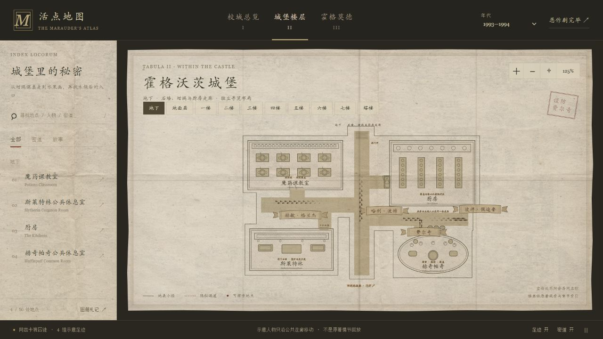

# 地下：坩埚、石墙与厨房走廊

四份已有档案改用独立 `dungeonPlan`，不增加地点数量：魔药教室、斯莱特林公共休息室、厨房、赫奇帕奇公共休息室。

## 看图时可以留意

- 魔药教室：材料架、小瓶和两排坩埚课桌。
- 斯莱特林：口令石墙、壁炉、皮沙发与长桌，不沿用其他学院的圆室家具。
- 厨房：炉台、四张备餐桌，以及走廊墙上的水果画。水果画本身可点开厨房档案。
- 赫奇帕奇：圆形空间、圆窗、植物、木桌，以及走廊木桶入口。木桶图形可打开相关档案，不新增敲击节奏小游戏。

## 接着探索

礼堂与厨房的档案互相连接；厨房与赫奇帕奇入口也能往返。`nearby` 数据提供目标与说明，沿用现有档案按钮、焦点返回和跨层选择，不把普通邻近关系伪装成密道。

地下图面下方的入口返回地面层门厅；它是楼层索引，不宣称准确楼梯位置。两种楼层索引共用文字与触摸尺寸逻辑。独立楼层的初始视野、标题与提示集中在 `floorGuides`，不继续堆叠楼层判断。

## 路线与检查

四条路线仅位于中部石廊和两翼通道，不进入房间，不触及水果画、木桶或家具。几何数据同时用于绘图、热区和行走；四个热区都由实际房间中心产生。

`npm run check` 当前包含 94,728 个楼层路径采样位置及双脚余量；另验证四张厨房备餐桌、入口符号、跨层目标和双向关联档案。

浏览器中验证了厨房 → 礼堂 → 厨房 → 赫奇帕奇 → 厨房，以及键盘返回门厅。三个年代均显示四处地点和四组人物；十组楼层均可切换，未记录到浏览器错误。

手机尺寸检查为 390×844 和 320×568 浏览器视口，不等于实体手机测试。320×568 下返回入口完整可见 44px。修复了“关闭档案后切年代重新弹出面板”的旧行为；已打开档案仍可随年代更新。

## 资料依据与边界

- [官方厨房条目](https://www.harrypotter.com/fact-file/locations/hogwarts-kitchens)：厨房位于礼堂下方，水果画入口，与赫奇帕奇休息室邻近。
- [J.K. Rowling：赫奇帕奇公共休息室](https://www.harrypotter.com/writing-by-jk-rowling/hufflepuff-common-room)：同一条走廊、木桶入口、低矮圆室、圆窗和植物。不是哈利在七部小说正文中实际参观过的房间。
- [官方斯莱特林公共休息室条目](https://www.harrypotter.com/fact-file/locations/the-slytherin-common-room)：地牢、隐藏石墙、口令、湖下位置和内部陈设。
- 魔药课以《魔法石》第8章等既有档案线索为依据。

只有明确的连接关系和地点特征用作事实；两翼排列、门位、距离、桌位和通道转折均为本图的导览重建。三个年代仍是人物组和档案状态，不模拟历史场景。
