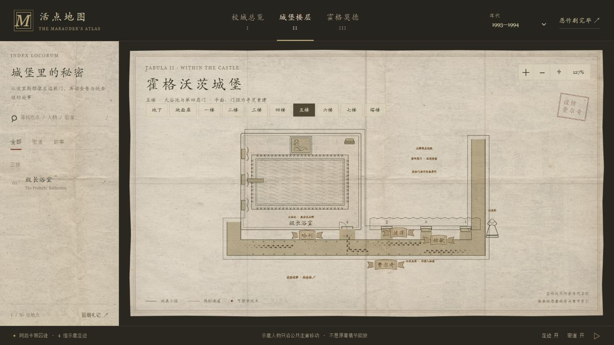
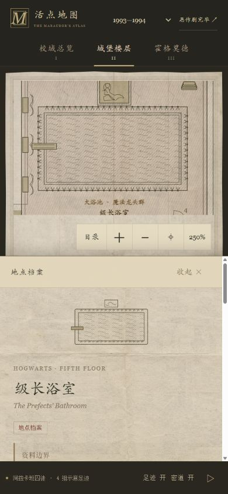

# 五楼：级长浴室与第四扇门

五楼改为独立导览平面，仍只保留已有的级长浴室档案。其余三扇门是地址线索，不给门后空间补造名称或平面。

## 可以留意的细节

- 浴室里有大浴池、重复排列的龙头符号、跳板、窗帘、毛巾和美人鱼画框。大理石以稀疏刻线表示，保持黑白版画与旧新闻纸的视觉。
- 波里斯雕像左侧的四个门位从近到远编号1至4，第四扇门通往级长浴室。距离、门宽、走廊转折及比例仍是本图的重建。
- 雕像、浴室入口与画像都可点击，也可用Enter或空格打开同一份档案，不制造额外地点数量。
- 画像按小说的金框画作线索重绘，档案缩略图也改成大浴池，不再是普通独立浴缸。
- 人物只沿公共走廊往返，不进入浴室与水面。姓名卷轴避开浴池、入口和门牌数字；手机门牌保持可辨认的大小。

## 故事与年代

金蛋线索明确放在1994—95学年。1976与1993的档案提示这个故事晚于所选年代；1998视为回望，不把Pine-fresh写成当年的现行口令。图面不放正在洗浴的人物，也不把金蛋当成全年留在浴室里的陈设。

级长浴室与桃金娘的盥洗室档案可双向翻阅，并保留年代。下缘的关联故事入口同样只做档案导航，**不是密道，也不表示两个浴室相邻**；没有画出桃金娘在管道中的轨迹。

## 依据与留白

- [官方级长浴室条目](https://www.harrypotter.com/fact-file/locations/prefects-bathroom)：五楼、雕像左边第四扇门、大浴池、水龙头与美人鱼画像。
- [官方专题及《火焰杯》摘录](https://www.harrypotter.com/features/the-five-places-we-would-most-want-to-visit-at-hogwarts)：浴池周边的龙头、跳板、窗帘、毛巾及金框画作。
- 《火焰杯》第23、25章继续作为指路与金蛋故事的作品依据。没有复述歌曲歌词。

龙头以重复小符号缩略，不逐个复刻书中数量、材质颜色或位置。画作内容、大理石纹路与家具摆放是本图的线描解释；原著并没有提供可直接照抄的精确建筑蓝图。

## 检查

`fifthPlan` 同时提供房间、门位、浴池、公共走廊和四组往返路径。十组楼层×三个年代共检查100,806个路径采样位置，包含左右脚偏移后的保守余量；另查第四扇门顺序、未补造其余三间房、图面特征、年代说明与双向档案目标。水面没有独立动画，原有落脚、磨损和暂停逻辑不变。

浏览器验证了桌面、390×844与320×568；入口命中区至少44×44 CSS像素，文字与点击区在画布内，键盘入口及档案往返正常。这些是浏览器视口检查，不是实体iOS/Safari或Android验收。
