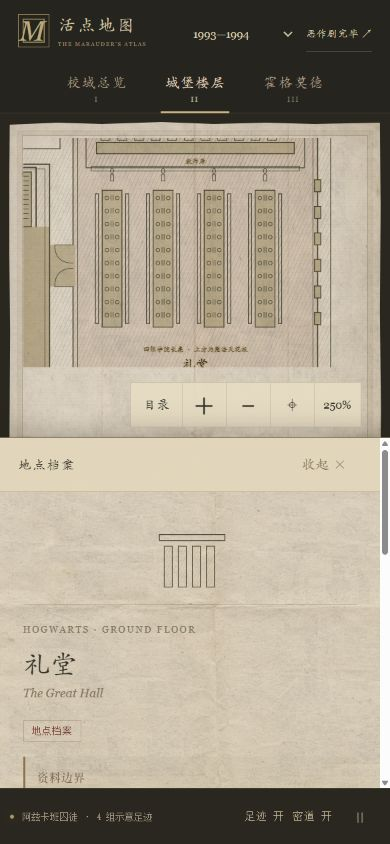

# 地面层：从橡木大门到礼堂

这一层使用独立的 `groundPlan`，不再复用四格十字走廊。地点档案数没有增加：门厅、礼堂、庭院三个既有条目分别拥有热区和对应空间。

## 布局与细节

- 门厅有大理石楼梯、四个学院沙漏和橡木大门。沙漏不显示虚构的年代分数。
- 礼堂有四张学院长桌、长凳、餐盘、教师席、蜡烛符号和窗。蜡烛是俯视图的装饰提示，不当作地面障碍。
- 庭院采用四面回廊、柱列和中央露天区域；具体位置及形状为原创新导览布局，不当作原著统一蓝图。
- 图上的“楼下厨房”和“上一楼”是档案/楼层索引链接，不宣称它们对应一条已确证的楼梯或新密道。点击或键盘 Enter/空格会使用既有档案导航。

## 人物路线

`groundPlan.rooms` 用于绘图和选择热区；`groundPlan.corridors` 定义公共通行区域。这里的门厅和庭院回廊允许人物通行，因此 `cells` 表示不可行走区域，而不是把全部命名空间封死。

不可通行区域包括礼堂内部、中央庭院、楼梯和沙漏所在区域。人物不穿过长桌，不在中央露天区域抄近路，不直接模拟上楼或下楼。

四条人物路线与渲染共享坐标；每一年代均检查左右脚偏移后的边界。地面层初次交付时全项目检查 94,503 个路径采样位置，地下层独立后为 94,728。另查四张长桌、教师席、四个沙漏、热区中心、跨层档案目标及平面选择。

## 浏览器验证

- 桌面逐一切换十组楼层，三个年代下核对地面层均有四组人物、四张长桌、四个沙漏和楼梯。
- 键盘 Enter 打开地下厨房，点击跳到一楼魔法史，均正确切换楼层并展开档案。
- 390×844 与 320×568 浏览器视口下，两个索引入口命中高度均不小于 44px，无页面横向溢出；礼堂档案保留上方地图与独立滚动区。
- 浏览器未记录到错误。以上属于浏览器视口测试，不声称已完成实体手机测试。

## 依据

- 《魔法石》第7章：初入城堡、门厅与大理石楼梯、礼堂。
- 《魔法石》第15章及原著学院分数线索：学院沙漏。摆放在图中的具体墙段不是精确测绘。
- [官方礼堂资料](https://www.harrypotter.com/fact-file/locations/the-great-hall)：礼堂与门厅相连、魔法天花板、悬浮蜡烛和用途。
- [官方厨房资料](https://www.harrypotter.com/fact-file/locations/hogwarts-kitchens)：厨房位于礼堂下方，桌上食物与楼上对应。

布局不随三个年代替换成历史场景；年代仍用于人物组和档案状态。庭院采用既有条目中明确标注的银幕式视觉，不据此补造原著相邻关系。
