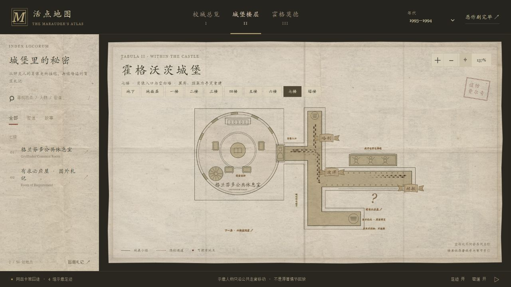
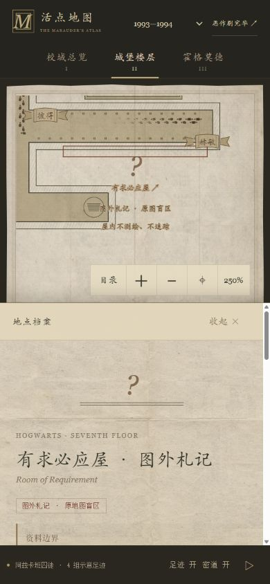

# 七楼：肖像入口与空白墙

七楼不再沿用共用四格平面。此轮仍是原来的两份档案：格兰芬多公共休息室与有求必应屋图外札记，没有增加地点数量。

## 图中可以找什么

- 圆形休息室：窗、炉火、扶手椅、桌上的书与通往寝室的螺旋楼梯。具体摆放由本图绘制，未补造寝室平面。
- 胖夫人肖像：可点击或用 Enter/空格打开公共休息室档案。肖像是入口符号，不是为四名示意人物敞开的门。
- 疯子巴拿巴挂毯：与空白墙隔着走廊相对，点击可读有求必应屋的线索。
- 墙旁的问号：本图册添加的图外札记标记，**不是原活点地图上的房间标记**。没有内部轮廓、家具或人物。
- 1998 年通道附注：仅在该年代显示阿利安娜肖像通道的注记线，不画成穿过盲区的行走路线。
- 六楼索引：下缘可翻到已有的六楼盥洗室档案，这是阅读导航，不是人物跨层移动。

两份七楼档案可以互相翻阅，提示明确写着“同层收录不表示相邻”。图中不还原某个夜晚的剧情；1993 年肖像曾由卡多根爵士暂时接替的事情仍放在档案里，没有被改成全年守门状态。

## 资料依据与留白

- [官方格兰芬多公共休息室条目](https://www.harrypotter.com/fact-file/locations/the-gryffindor-common-room)：圆形房间、口令与胖夫人肖像、炉火、沙发和寝室螺旋楼梯。
- [官方有求必应屋条目](https://www.harrypotter.com/fact-file/locations/the-room-of-requirement)：七楼、疯子巴拿巴训练巨怪跳芭蕾的挂毯、对面的墙及来回三次的进入方式。
- [官方隐秘空间专题](https://www.harrypotter.com/features/the-camouflaged-corners-and-secret-spaces-of-hogwarts)：猪头酒吧肖像后的通道；档案继续标注《死亡圣器》第29章。
- 盲区依据保留《混血王子》第21章。不把人物提出的缺失原因画成确定的魔法原理。

这些资料不能确定两处相邻、走廊转折、门位、距离或家具位置。图册的翼廊与相对坐标仍是导览重建；不会凭空补出一张官方七楼蓝图。挂毯本身不是密道门，画上的图案也是本图的小幅线描解释。

## 工程与检查

`seventhPlan` 区分 `rooms` 与 `notes`：公共休息室是绘制的房间；有求必应屋只保留用于聚焦与点击的札记范围，SVG 中不存在 `data-room="requirement"`。公共走廊、肖像、挂毯、墙和梯口的边界与人物巡逻共用同一套几何。

四组脚印只在公共走廊内往返，不进入休息室、肖像、挂毯、梯口或盲区，不沿图外附注行走。十组楼层、三个年代共检查 94,815 个路径采样位置，并检查左右脚偏移后的余量。另查七楼档案热区中心、五个独立平面的选择、盲区无内部平面、阿利安娜注记仅在1998年出现，以及每个年代状态都保留盲区说明。

手机沿用上一轮的自适应取景、简称姓名与短屏页眉。肖像、挂毯、札记和跨层索引的点击区至少44×44 CSS像素，放大文字后命中矩形也覆盖整段线索。缩屏时选中的楼层签留在可见范围内，不滚动整个工作区。

浏览器检查使用390×844、320×568和桌面尺寸，不等同于实体iOS/Safari或Android验收。路线测试验证图册内部一致性，不证明原著地理坐标。

